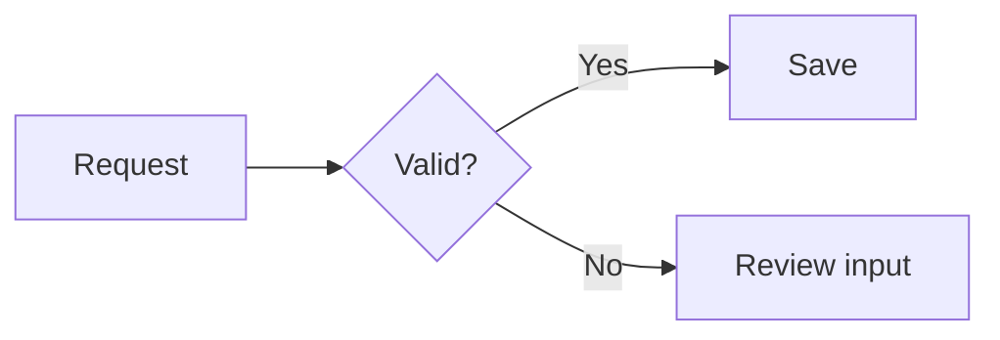

# Create a LocalEditor diagram

Use LocalEditor's discovered MCP document tools to keep a diagram as ordinary
Markdown source. Read [format routing](../../references/diagram-routing.md)
when choosing between Mermaid and Canvas, and follow the shared
[document workflow](../../references/document-workflows.md) for activity,
revision checks and review handoffs.

## Preserve the requested format and destination

Honor explicit Mermaid/Canvas choices and existing file formats. For an
unspecified structured diagram, use a `mermaid` fence in a `.md` Page or
Scratchpad. Default layout is automatic; requests for custom spatial layout,
wireframes, sketches or direct shape editing belong to Canvas. Ask before
converting an existing document. A mixed Page can contain Mermaid and an
embedded Canvas; no child file is needed just for an inline diagram.

Discover the named Project or Scratchpad and use its returned path. Do not
replace the intended destination with a new Scratchpad merely for convenience.
For a new Scratchpad use `create_scratchpad` with title and Markdown content.
For a new Project Page use `write_document` with `create:true` in an existing
writable folder. Existing-target edits begin activity before preparation,
then read the latest document and write once with its `expectedRevision`.
Preserve frontmatter, prose, unrelated fences, notes and checkmarks. Renew and
finish activity as the shared workflow requires.

## Write portable diagram source

Use the simplest supported diagram for the explanation. Keep IDs stable when
editing, make labels readable, and keep surrounding context outside the fence.
For example:

A process defaults to a flowchart; interactions over time can use a sequence
and relationships can use class/ER syntax. Choose other diagram types only
when they serve the request and the app supports them. Keep a single diagram
below the renderer's 50,000-character source limit; split a large explanation
into coherent diagrams when useful. Store only Mermaid source in the fence,
never rendered SVG, error markup, theme settings or pan/zoom state.

LocalEditor renders with bundled Pele, so full Mermaid compatibility is not
implied. Do not rely on external plugins, arbitrary HTML labels, diagram image
loading, clickable diagram links or remote rendering services. Theme/accent
and fonts come from the app. Standalone `.mmd`/`.mermaid` preview, visual node
editing and Canvas conversion are outside this version. If requested syntax
is unsupported, explain the limitation and agree on a faithful alternative
instead of silently switching formats.

## Review honestly

The updated helper's initialize instructions advertise Mermaid preview support.
If it is not advertised, keep requested Markdown source work usable but do not
promise a preview; explain the compatible app/helper requirement when relevant.
Never infer installed capabilities from the plugin version.

`render_canvas` cannot render or validate Mermaid. A saved/re-read fence is
source confirmation only; do not claim the diagram was visually checked or
parsed successfully from that alone. Use only a verification capability that
is actually available and authorized; otherwise hand the saved Page back for
preview review. Finish activity before the normal focus-preserving handoff.
